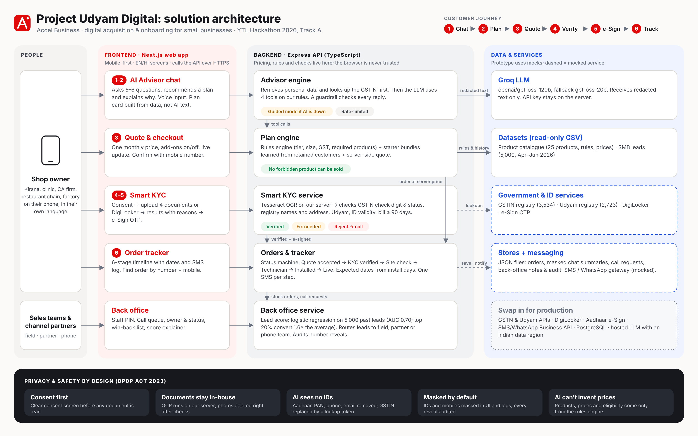

# Project Udyam Digital

**Airtel SYNC × YTL Hackathon 2026 · Enterprise Track A · Team Code Pioneers**

A small business owner finds the right telecom bundle, buys it, verifies their business and tracks installation, all on a phone, in their own language, with no salesperson. The operator (Accel Business) and all data are fictional or synthetic, as given in the case.

| | |
|---|---|
| **Live app** | https://airtel-sync-hack-code-pioneers.vercel.app |
| **Backend API** | https://airtel-udyam-digital-backend.onrender.com (`/api/health`) |
| **Back office** | https://airtel-sync-hack-code-pioneers.vercel.app/backoffice (demo staff PIN `2468`) |
| **Architecture** | [`docs/architecture.png`](docs/architecture.png) |

> The backend runs on Render's free plan. The very first document check after a restart takes longer while the OCR engine loads (about 30–45 s), and later checks take about 20 s.



## What the owner does (the 6-step journey)

1. **Chat:** the owner picks one of 11 languages (English, हिंदी, Hinglish, मराठी, தமிழ், తెలుగు, ಕನ್ನಡ, ગુજરાતી, বাংলা, ਪੰਜਾਬੀ, മലയാളം) and describes the business, by typing or using the mic.
2. **Plan:** the advisor recommends a bundle with one monthly price and explains why in plain words.
3. **Quote:** the owner toggles add-ons, and the price updates instantly (recalculated by the server).
4. **Verify:** after consent, the owner uploads 4 documents (or uses mock DigiLocker). OCR reads them and checks them against the GSTIN and Udyam registries.
5. **e-Sign:** a one-time code signs the order.
6. **Track:** a live timeline with SMS updates, so the owner never has to call support.

If the AI cannot close the deal (call request, big business, rejected or stuck KYC), the lead goes to the **back office**, ranked by a lead score and routed to field sales, a channel partner or inside sales.

## Coverage of the problem statement

| Requirement | Status | Where |
|---|---|---|
| **Advisor:** GenAI assistant asks about the business and recommends a bundle in plain language | ✅ | `backend/src/lib/advisor/`, `/` |
| **Quote & checkout:** one transparent monthly price, add-ons the owner can toggle | ✅ | `backend/src/lib/quote.ts`, `/quote` |
| **Smart KYC:** upload, extraction and validation, mocked GSTIN/Udyam lookups, clear consent screen | ✅ | `backend/src/lib/kyc/`, `/kyc/[id]` |
| **Tracker:** order status the owner checks instead of calling | ✅ | `backend/src/lib/tracker.ts`, `/order/[id]`, `/track` |
| Stretch: voice front end | ✅ (voice input via the browser mic, 11 languages) | `frontend/components/chat/MicButton.tsx` |
| Stretch: back office of leads the advisor could not close | ✅ | `backend/src/lib/backoffice/queue.ts`, `/backoffice` |
| Stretch: propensity score for which leads to call | ✅ (AUC 0.70, top 20% convert 1.6× the average) | `backend/src/lib/backoffice/model.ts` |
| Advisor never breaks catalogue eligibility rules | ✅ (rules engine in code, tested on 1,000+ combinations) | `backend/src/lib/rules.ts` |

## Key design choices

- **"The AI talks, the code decides."** The LLM (Groq `openai/gpt-oss-120b`, falling back to `gpt-oss-20b`) only chats and calls our tools. Eligibility, prices, dependencies and plans all come from a deterministic rules engine. A guardrail checks every AI reply against the real plan before the owner sees it. A WhatsApp request without GST, a 1 Gbps request in a tier-2 city or a discount demand can never get through.
- **Always works.** If the LLM is down or rate-limited, the chat switches to a guided mode that still produces a valid plan.
- **Plans from real behaviour.** Starter bundles come from what similar customers in `smb_leads.csv` bought and kept for 6+ months.
- **Smart KYC on our own server.** Tesseract OCR with image clean-up (tilted photos work) is followed by checks:
  - GSTIN checksum and registry status
  - Udyam number
  - name match across documents
  - address-proof freshness
  - signatory ID

  The result is Verified, Fix needed or Rejected, with a plain-language reason for each check. All 12 sample applicants match the answer key.
- **Lead score:** a logistic regression trained at startup on 4,000 past leads and tested on 1,000 it never saw. A "win-back" list ranks 1,632 past leads lost only because nobody visited or reached them.
- **Simulated date:** following the dataset README, "today" is fixed at **15 July 2026**, so activation dates and the tracker use July 2026.

## Privacy and security (DPDP Act 2023)

- **Consent first:** documents cannot be uploaded before the owner agrees, on a plain-language consent screen. That screen states the purpose, what is collected and how long it is kept.
- **Data minimisation:** the LLM only ever sees redacted text. A GSTIN is looked up on our server and replaced with a token, and Aadhaar, PAN, mobile numbers and emails are removed. Chat text stays in memory and is deleted after 30 idle minutes.
- **Masking:**
  - Mobile, GSTIN and Udyam numbers are masked in every response and log.
  - Uploaded images are processed in memory and never saved.
  - Only check results are kept.
- **Staff access:** the back office needs a staff PIN (checked in constant time, rate-limited). Every full-number reveal is written to an audit log.
- **Secrets:** the Groq key lives only on the server (`backend/.env`, git-ignored).

## Tech stack

- **Frontend:** Next.js 16 + TypeScript + Tailwind v4, mobile-first, deployed on **Vercel**.
- **Backend:** Express 5 + TypeScript (tsx), deployed on **Render**, with a keep-alive ping to `/api/health` every 10 minutes.
- **AI:** Groq SDK with tool calling. **OCR:** tesseract.js + sharp.
- **Tests:** Vitest + supertest, 140 backend tests (the LLM is mocked). Live advisor evaluation is in [`docs/advisor-eval.md`](docs/advisor-eval.md).
- **Storage:** the hackathon CSVs (read-only) and JSON files for orders, call requests and back-office notes. Production would use PostgreSQL plus the real GSTN, Udyam, DigiLocker, Aadhaar e-Sign and SMS services.

## Try it (demo script)

1. Open the live app, choose **English** or **हिंदी**, and type: *"I run a dental clinic in Pune, 6 staff, one location, we have GST, need fast internet and email."*
2. Try an edge case: *"Kirana in Agra, 2 staff, no GST, I want WhatsApp Business API."* The advisor explains why it's not allowed and offers an alternative.
3. Open the quote, toggle add-ons, enter any 10-digit mobile number and place the order.
4. On the KYC screen, accept consent, choose **Fetch from DigiLocker**, and pick a sample business:
   - **K12:** Verified
   - **K11:** Fix needed (old electricity bill)
   - **K06:** Rejected (fake GSTIN)
5. For a verified applicant, finish e-sign with the demo code shown on screen. Then use **"Move installation to the next step"** (demo control) on the tracker to reach *All services are live*.
6. Open **/backoffice** with PIN `2468` to see the ranked call queue, routing, the funnel and the win-back list.

## Run locally

```bash
cp backend/.env.example backend/.env    # add your GROQ_API_KEY (optional: without it, guided mode)
npm run install:all                     # root + backend + frontend
npm run dev                             # backend http://localhost:4000 + frontend http://localhost:3000
npm test                                # backend tests
npm run eval:advisor --prefix backend   # live advisor evaluation against Groq
```

### Environment variables

| Where | Variable | Purpose |
|---|---|---|
| backend | `GROQ_API_KEY` | LLM key (server only) |
| backend | `GROQ_MODEL`, `GROQ_FALLBACK_MODEL` | `openai/gpt-oss-120b`, `openai/gpt-oss-20b` |
| backend | `CORS_ORIGIN` | the frontend URL allowed to call the API |
| backend | `BACKOFFICE_PIN` | staff PIN (demo default `2468`) |
| backend | `DEMO_CONTROLS` | `true` shows the demo "next installation step" button |
| frontend | `NEXT_PUBLIC_API_URL` | backend URL |

### Deploy

- **Render (backend):**
  - root `backend`
  - build `npm install --include=dev`
  - start `npm start`
  - health check `/api/health`
- **Vercel (frontend):** root `frontend` and `NEXT_PUBLIC_API_URL` set to the Render URL.
- **Keep-alive:** a free cron-job.org job pings `/api/health` every 10 minutes. On the free plan, saved orders reset when the backend restarts or redeploys.

## Repository layout

```
backend/            Express API: all business logic
  src/lib/rules.ts       catalogue eligibility and dependencies
  src/lib/quote.ts       pricing
  src/lib/starter.ts     starter bundles from retained customers
  src/lib/advisor/       AI advisor: LLM, tools, guardrail, redaction, guided mode
  src/lib/kyc/           OCR, parsing, checks, consent, e-sign
  src/lib/tracker.ts     order timeline + SMS
  src/lib/backoffice/    lead score model, queue, routing, win-back list
  data/                  hackathon CSVs + 12 sample KYC applicants
  tests/                 Vitest tests
frontend/           Next.js app: screens only, no business logic
docs/               problem statement, architecture diagram, advisor evaluation
```

Not a real Airtel product; built for the hackathon on synthetic data.
